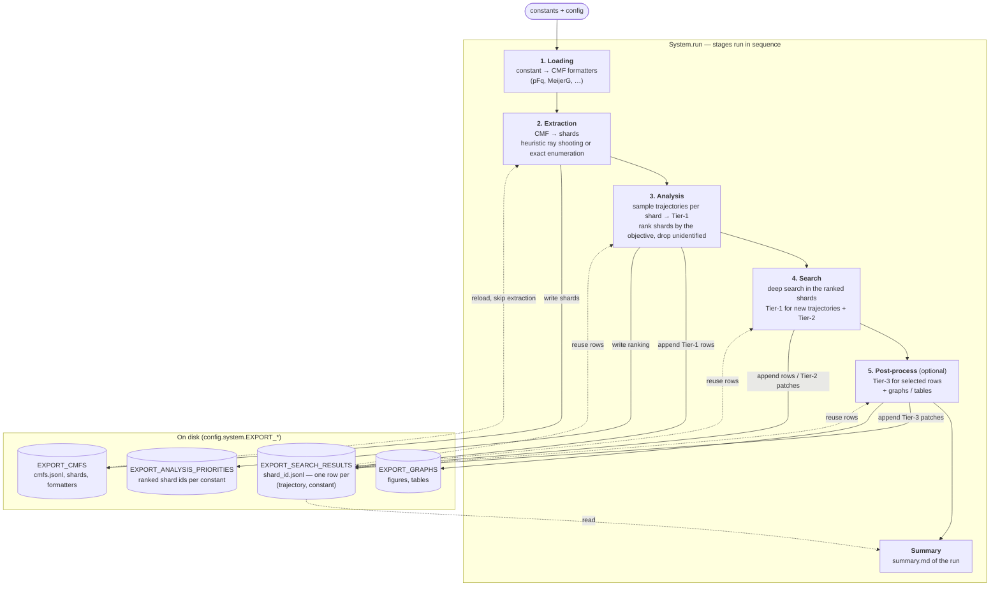
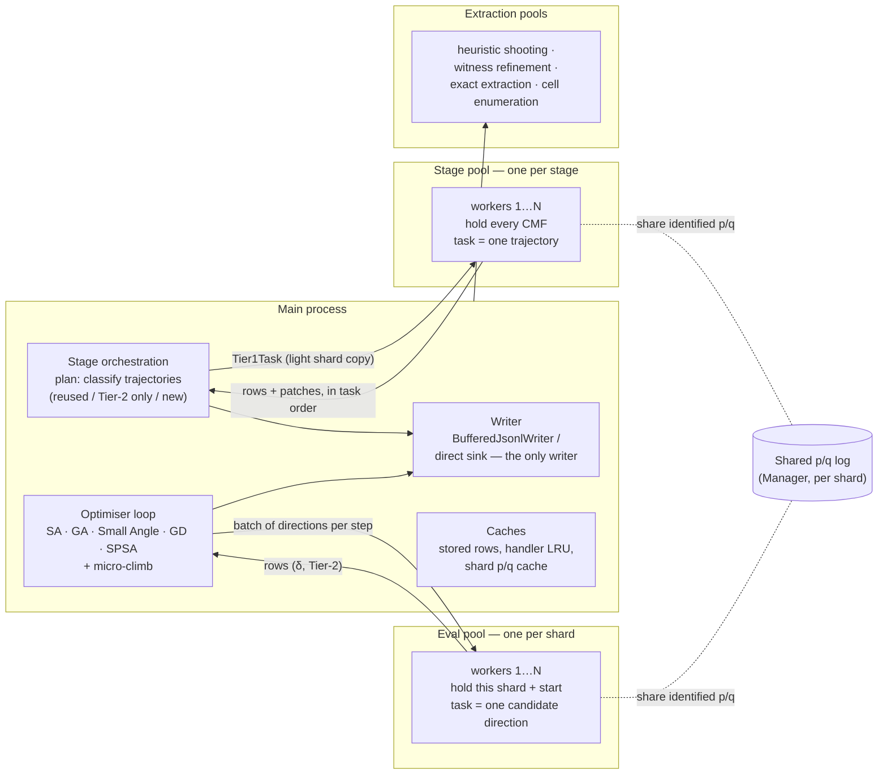
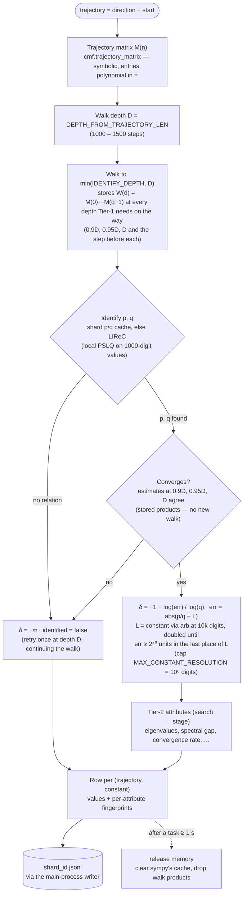
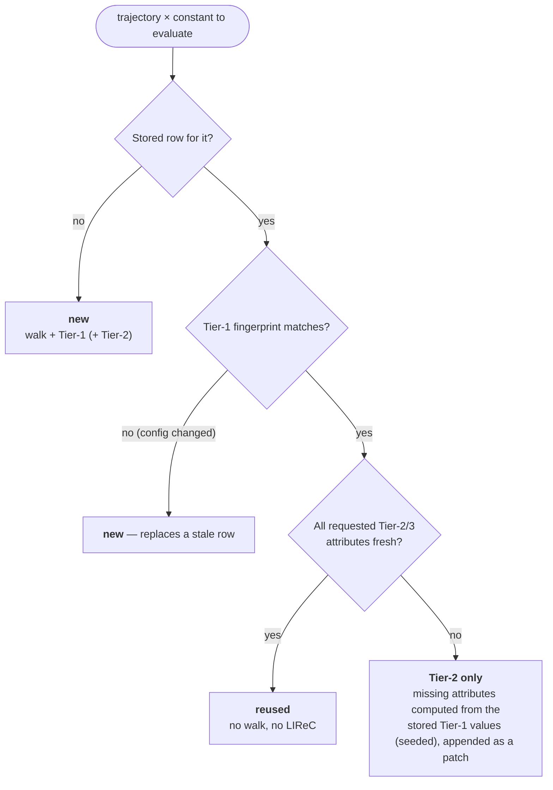
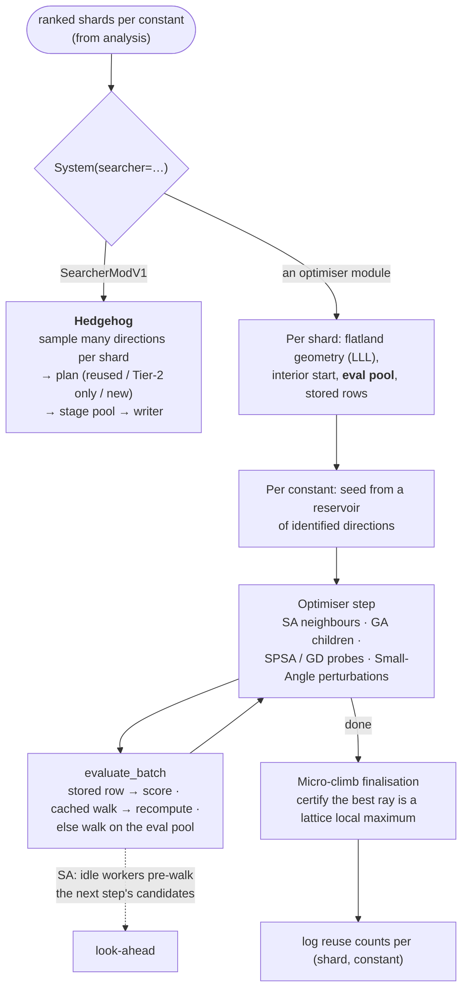
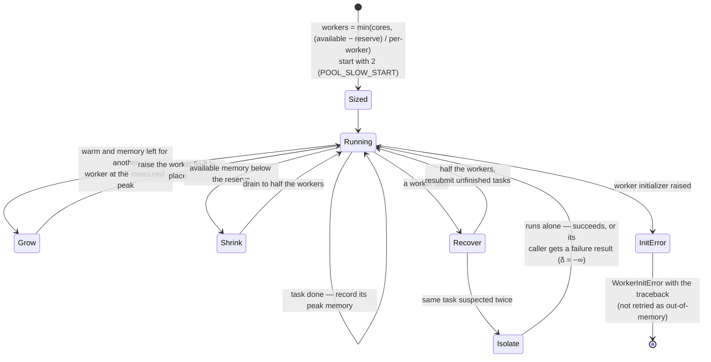

# Ramanujan's Dreams — Architecture

How a run flows through the system: the stages, the processes that do the work,
what one trajectory's computation involves, when stored work is reused, and how
the pools survive failures. The diagrams are [Mermaid](https://mermaid.js.org/):
GitHub renders them in place, and `npx -p @mermaid-js/mermaid-cli mmdc -i ARCHITECTURE.md -o arch.svg`
(or `-o arch.png`) exports them as images.

Contents:
1. [Pipeline](#1-pipeline) — stages, what each reads and writes
2. [Processes](#2-processes-and-pools) — main process, stage pools, eval pools, extraction pools
3. [One trajectory](#3-one-trajectory) — walk, identification, δ, Tier-2, rows
4. [Reuse](#4-reuse-what-is-computed-again-and-what-is-not) — fingerprints and reuse counts
5. [Search](#5-search-hedgehog-and-the-optimisers) — hedgehog vs. the optimisers
6. [Resilience and memory](#6-resilience-and-memory) — dead workers, memory-aware sizing

Terms used throughout:

| Term | Meaning |
|---|---|
| **CMF** | Conservative matrix field; the input object a constant is searched in. |
| **Shard** | One cell of a CMF's hyperplane arrangement; trajectories inside a shard share behaviour. |
| **Trajectory** | A direction + start point in a shard; walking it yields a sequence converging to a constant. |
| **Tier-1** | δ, identified, p/q vectors, projection column — computed for every trajectory. |
| **Tier-2** | Extra attributes (`search.TIER2_ATTRIBUTES`) computed during search. |
| **Tier-3** | Expensive attributes (`post_process.TIER3_ATTRIBUTES`) computed after search. |
| **Row** | One `(trajectory, constant)` record in `<shard_id>.jsonl` — the shared store. |
| **Stage pool** | A process pool per stage; one task = one trajectory. |
| **Eval pool** | A process pool per shard inside an optimiser; one task = one candidate direction. |

---

## 1. Pipeline

The stages run one after another (`System.run`); the parallelism is inside each
stage. Every stage reads and appends to the same per-shard store, so a later
stage — or a later run — reuses what an earlier one computed.



---

## 2. Processes and pools

Only the main process orchestrates and writes files. All heavy work runs in
process pools, and every pool is a `ResilientPool` (section 6). The two pools that
compute trajectories differ in what one task is and who waits for it.



| | Stage pool (`StagePool`) | Eval pool (`make_eval_pool`) |
|---|---|---|
| Used by | analysis, hedgehog search, Tier-3 | the optimisers and the micro-climb |
| Lifetime | one stage, all shards | one shard, all its constants |
| One task | one trajectory: Tier-1 rows + Tier-2/3 for its constants | one candidate direction of an optimiser step |
| Waits | the stage streams all trajectories through it | the optimiser waits per step (SA may pre-walk the next step) |

Workers start with `forkserver` on Linux and `spawn` on macOS
(`system.POOL_START_METHOD`), and their number is fitted to cores and memory.

---

## 3. One trajectory

What a stage-pool task (or an eval-pool walk) does for one trajectory. The walk
products are exact rational matrices; the constant is evaluated with FLINT arb.



---

## 4. Reuse: what is computed again and what is not

Every stored value carries a **fingerprint** of the configuration it depends on
(its own knobs plus its dependencies' fingerprints). A value is reused while its
fingerprint matches; `system.REUSE_POLICY` can also keep everything (`keep`) or
ignore earlier runs (`recompute`).



Each stage logs how its work was served:

```text
Shard pFq_2_1_…: 120 trajectories → 80 reused · 10 Tier-2 only · 30 new            (analysis, hedgehog)
Simulated Annealing — shard pFq_2_1_…, log-2: 412 evaluations →
    150 reused · 190 revisited · 72 new (4 replacing stale rows)                    (optimisers, micro-climb)
```

`revisited` = computed earlier in the same run (an optimiser returned to a ray).

---

## 5. Search: hedgehog and the optimisers



---

## 6. Resilience and memory

A worker killed by the out-of-memory killer used to hang `multiprocessing.Pool`
forever. `ResilientPool` notices the death, recovers, and keeps memory in check.



Memory per long trajectory (4F3, L2 128, depth 1000): walk ~16 MB, δ ~0 MB
(arb), peak ~0.4 GB per worker; sympy's cache is cleared after tasks ≥ 1 s so
nothing accumulates across trajectories.
